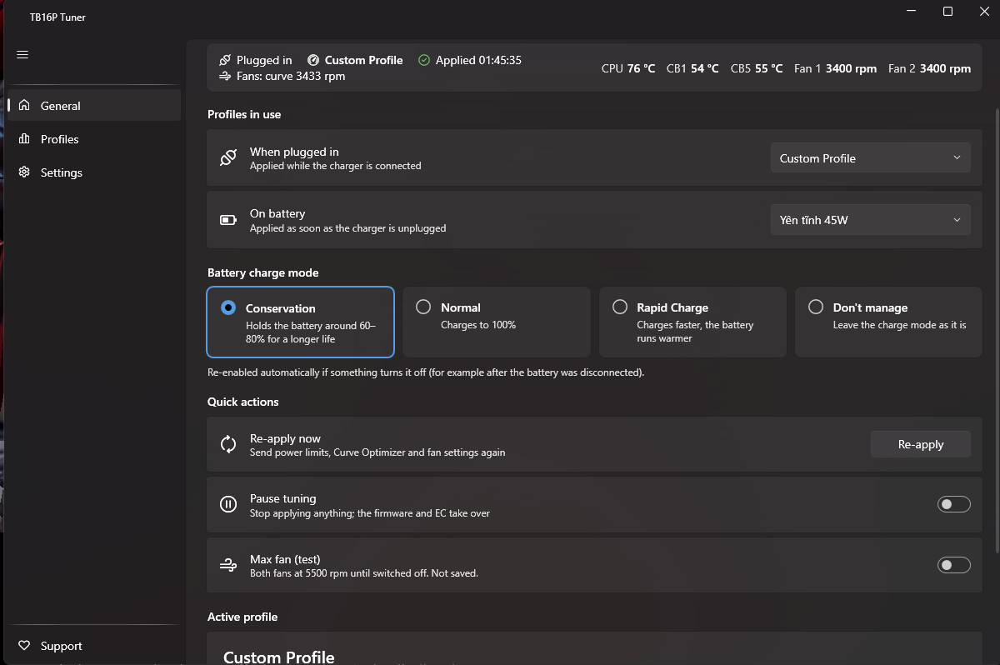
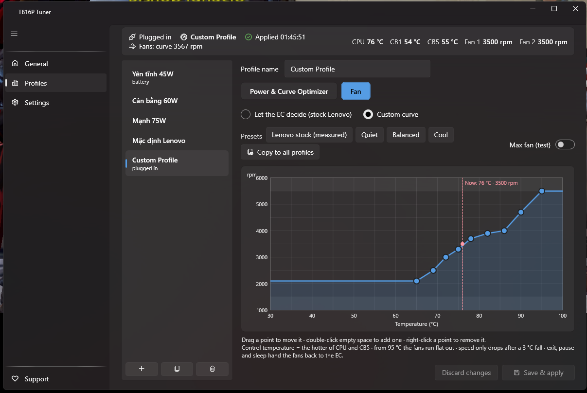
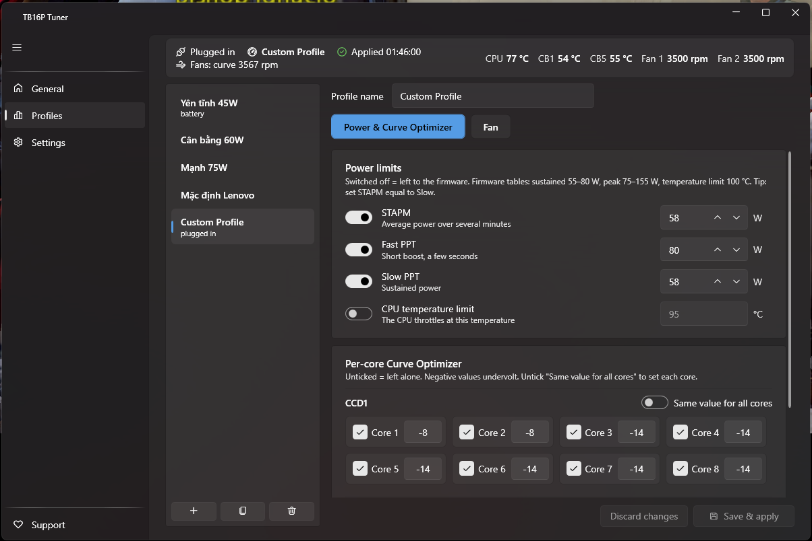

# TB16P Tuner

**Power, fan & battery tuner for Lenovo ThinkBook 16p.**

Power limits, per-core Curve Optimizer, custom fan curves and battery charge modes for the **ThinkBook 16p G6 ADR (21U0, Ryzen 9 8945HX)**, the China-market model that ships without Lenovo's tuning software. English and Vietnamese UI, light and dark theme.

> ⚠️ Only for **AMD Dragon Range** CPUs (family 19h model 61h). The app checks the CPU and refuses to tune anything else. Changing power limits, voltages and fan speeds is at your own risk.



## Why

**No software could control the fans on this laptop.** Lenovo ships no tuning app for this model, and third-party tools such as Lenovo Legion Toolkit do not support the ThinkBook. Fn+Q only switches between Eco / Auto / Performance, and the stock fan curve lets the CPU run hot.

A fan-only tool would still have to run next to UXTU for power limits and Curve Optimizer, so TB16P Tuner does both in one app, and adds battery charge modes as well, so Lenovo Legion Toolkit is not needed just to keep Conservation mode on. One tray app instead of three.

## Features

- **Profiles** with STAPM / Fast / Slow power limits, a CPU temperature limit and **per-core Curve Optimizer** (2 CCDs × 8 cores, one value per CCD or per core).
- **Automatic profile switching** when the charger is plugged in or unplugged, and re-apply after resume from sleep.
- **Keeps the limits applied**: the EC silently restores its own power table after a few minutes, so limits are re-sent every few seconds (2 s by default) and Curve Optimizer every 30 s, like UXTU's re-apply. The Dragon Range PM table cannot be read, so the override cannot be detected and is simply re-sent on a timer.
- **Custom fan curves** per profile: drag points freely (any temperature, not fixed steps), double-click to add, right-click to remove. Includes a **"Lenovo stock (measured)"** preset reconstructed from real EC behaviour ([how](docs/stock-fan-curve.md)), plus Quiet / Balanced / Cool. Safety: full speed from 95 °C, fans handed back to the EC on exit, pause, sleep or a crash.
- **Battery charge mode**: Conservation / Normal / Rapid Charge, re-enabled automatically if something turns it off (for example after the battery was disconnected while cleaning the laptop).
- Live status: CPU and EC temperatures, both fan speeds, the active profile and errors.
- Tray icon, start with Windows through Task Scheduler (admin rights without a UAC prompt on every boot), optional sensor log to CSV.

| Fan curve | Power & Curve Optimizer |
|---|---|
|  |  |

## Install

1. Download **`TB16PTuner-vX.Y.Z-setup.exe`** from [Releases](../../releases) and run it. .NET is built in, nothing else needs installing.
   A portable `.zip` is there too: unzip anywhere and run `TB16PTuner.exe`.
2. **Microsoft Defender blocks the WinRing0 driver** the app needs for power limits and Curve Optimizer. Either tick *"Add the install folder to Microsoft Defender exclusions"* in the installer, or add the folder yourself under **Windows Security → Virus & threat protection → Exclusions**. Fan control and charge modes work without it.
3. Quit UXTU / Lenovo Legion Toolkit (and turn off their auto-start) so the tools do not overwrite each other.
4. Start TB16P Tuner (it asks for admin rights) and turn on **Settings → Start with Windows**.

Windows SmartScreen may warn about an unknown publisher because the app is not code-signed: choose *More info → Run anyway*.

Settings live in `C:\ProgramData\TB16PTuner\settings.json`, the log in `log.txt` next to it.

## Build from source

Requirements: Windows 10/11 x64, .NET 8 SDK.

```powershell
powershell -ExecutionPolicy Bypass -File .\publish.ps1   # builds .\app\TB16PTuner.exe
powershell -ExecutionPolicy Bypass -File .\release.ps1   # portable zip + installer (needs Inno Setup 6)
```

| Folder | Contents |
|---|---|
| `src/Tb16p.Core` | SMU mailbox over WinRing0, Dragon Range commands, Curve Optimizer, charge mode via `\\.\EnergyDrv`, GameZone sensors and fans, settings |
| `src/Tb16p.Service` | Tuning engine (re-apply loop, fan control), sensor logger, logon task |
| `src/Tb16p.Ui` | WPF app (WPF-UI / Fluent), tray icon, English and Vietnamese strings |
| `src/Tb16p.App` | Previous WinForms app, kept until the WPF one has proven itself |
| `src/Tb16p.Cli` | Command line tool for experiments (`tb16p info \| limits \| co \| battery`) |
| `installer/` | Inno Setup script |
| `vendor/WinRing0` | WinRing0 driver |

## Technical notes (ThinkBook 16p G6 ADR)

- Fn+Q modes go through Lenovo Dispatcher's ITS/DYTC (`HKLM\SYSTEM\CurrentControlSet\Services\LenovoProcessManagement\Performance\PowerSlider`, `ITS_CurrentSetting`: 0 = auto, 1 = eco, 3 = performance). The Dispatcher does **not** set PLx on AMD; the EC/firmware is what overwrites the limits.
- The BIOS exposes Lenovo's GameZone WMI interface (`ACPI\PNP0C14\GMZN`) like the Legion line. Temperature and fan getters work; `SetSmartFanMode` / `Fan_Set_Table` have no effect, but setting a fan speed directly (feature `0x0403000x`, EC command 0xD1) does, and 0 hands the fans back to the EC.
- Firmware power tables (Quiet / Balanced / Performance): sustained 55/70/80 W, peak 75/102/155 W, temperature limit 100 °C.
- The stock EC fan curve runs in fixed steps (2100 → 3100 / 3400 / 3700 / 3900 rpm at 76 / 79 / 82 / 85 °C) and is much gentler than the BIOS fan tables suggest. See [docs/stock-fan-curve.md](docs/stock-fan-curve.md).
- RyzenAdj 0.19 crashes on this machine (it cannot read the Dragon Range PM table), so the app implements the SMU mailbox protocol itself.

## Support

TB16P Tuner is free and open source. If it made your ThinkBook 16p quieter, cooler or last longer on battery, a coffee keeps the project going:

- **PayPal:** [paypal.me/nmhthien](https://paypal.me/nmhthien)
- **Bank transfer in Vietnam (VietQR, Vietcombank):**

  

## Credits

- [Universal x86 Tuning Utility](https://github.com/JamesCJ60/Universal-x86-Tuning-Utility) (GPL-3.0): SMU mailbox addresses, Dragon Range commands and per-core Curve Optimizer encoding.
- [RyzenAdj](https://github.com/FlyGoat/RyzenAdj) (LGPL-3.0): SMU mailbox protocol; the WinRing0 build.
- [Lenovo Legion Toolkit](https://github.com/BartoszCichecki/LenovoLegionToolkit): battery charge mode IOCTL via `\\.\EnergyDrv`.
- WinRing0 / OpenLibSys by hiyohiyo.
- UI built with [WPF-UI](https://github.com/lepoco/wpfui) and [CommunityToolkit.Mvvm](https://github.com/CommunityToolkit/dotnet).

Not affiliated with Lenovo. ThinkBook is a trademark of Lenovo.

## License

GPL-3.0, see [LICENSE](LICENSE).
